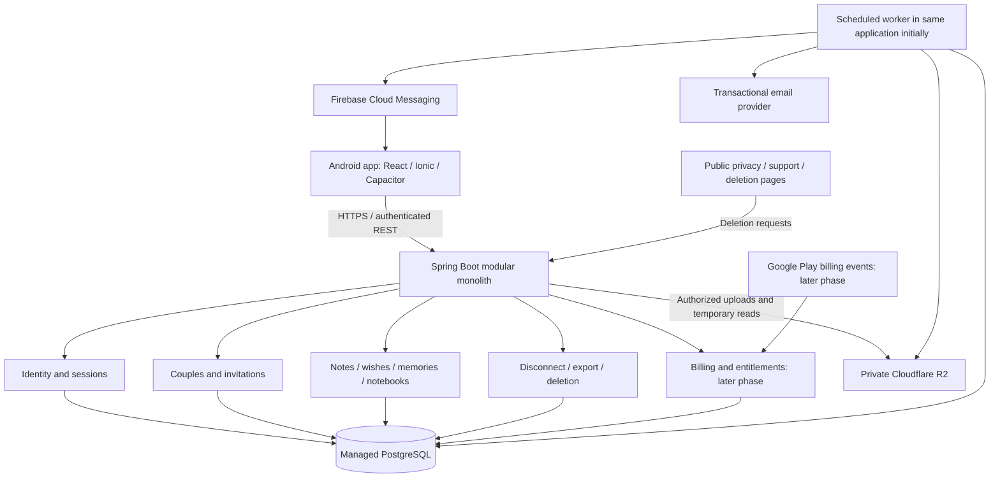

# Couples app: architecture and launch roadmap

Status: implementation in progress; release gates remain open. Updated: 2026-10-25.

Implementation status (2026-10-25): [working couples app, setup, verification and remaining release gates](backend/COUPLES_FOUNDATION.md). Accounts, verification/recovery, revocable sessions, invitations, two-way notes/memories, scoped watchlist/recipes/wishes, personal birthday reminders, disconnect, export and deletion are implemented in the separate couples backend/mobile mode. Hosted deployment, native-device verification and the later beta/paid-launch phases remain open.

This document describes how to turn Life Organizer into an Android product for many couples. It does not mean these capabilities already exist. The existing [architecture](ARCHITECTURE.md) describes the original two-account gift app; this document is the proposed architecture for its commercial evolution.

## 1. Product direction

**A private space for two people to share everyday plans and meaningful moments.**

Start with a small Android beta for 10–20 couples. Validate whether both partners return regularly before expanding features or introducing paid subscriptions. Initial audience proposal: adult couples, with one active couple space per account. Choose the launch country and language before publishing.

| Include in the first couples beta | Defer until demand is demonstrated |
| --- | --- |
| Individual accounts and partner invitations | iOS launch |
| Two-way notes, wishes, temporary memories from both partners | General-purpose chat, video calls, AI features |
| Existing recipes and watchlist as shared planning tools | New calendar and shopping-list modules |
| Personal birthday reminders | Commercial gym coaching and the agios module |
| Privacy settings, disconnect, deletion and support | Public profiles, discovery and social feeds |
| Reliable notifications and useful empty states | Subscriptions and permanent media storage |

Existing modules deferred from the commercial beta must either be inaccessible through the API in that deployment or meet the same isolation requirements as enabled modules. Hiding navigation is insufficient. Keep the original personal deployment separately if those features remain useful there.

Success measures: invite acceptance, time until both partners complete a first action, weekly activity by both partners, retention after four weeks, reported problems, and willingness to pay. Define numerical targets before recruiting testers; they are business hypotheses, not established benchmarks.

## 2. Architecture decision

**Adopt a modular monolith: one Spring Boot application, one PostgreSQL database with a shared schema, and an explicit couple boundary on shared data. Keep React, Ionic and Capacitor for Android.**

The couple is the tenant: the private workspace that owns shared content. Accounts exist independently of membership so people can register, recover access and disconnect without losing their identity.

This fits the existing code and a small team: transactions, migrations and deployments remain manageable while modules have clear responsibilities. Microservices, a database per couple, Kubernetes, Kafka and a full mobile rewrite are unnecessary for the beta. Revisit deployment separation when measured throughput, operational needs or team ownership justify it.

### Module boundaries

Keep the current feature packages. Introduce the following responsibilities without a wholesale package rewrite:

| Module | Responsibility |
| --- | --- |
| `auth` / `identity` | Accounts, verification, login, password reset, sessions and devices |
| `couples` | Membership, invitations, authorization context and disconnect |
| Existing feature packages | Feature behavior and scoped persistence |
| `media` | Upload validation, asset ownership, quotas, signed reads and cleanup |
| `notifications` / `push` | Personal inbox, preferences, device routing and delivery |
| `billing` | Verified purchases, subscription lifecycle and couple entitlements |
| `privacy` | Export, account deletion and retention workflows |
| `jobs` | Durable work records, claiming, retries and operational visibility |

Controllers validate HTTP requests; application services enforce permissions and transactions; repositories perform scoped queries; provider adapters handle R2, FCM, email and Google Play. Cross-module operations use explicit service methods or durable events. Avoid a large generic framework or unrestricted repository access across modules.

## 3. What must change in this repository

| Current implementation | Required evolution |
| --- | --- |
| `auth/User.java`, `seed/DataSeeder.java`: two fixed users | Independent accounts; seed accounts only in development/demo environments |
| `OWNER` / `RECIPIENT` in backend controllers and mobile auth | Both partners are members; permissions depend on membership, authorship and visibility |
| `UserRepository.findByRole(...)` used to select people | Resolve participants within the authenticated couple or explicit personal owner |
| Watchlist and other services query shared collections globally | Scope every read, write, count, search and child lookup |
| One FCM token stored on `User` | Per-device registrations and per-session revocation |
| Long-lived JWT persisted in mobile `localStorage` | Short-lived access tokens and revocable, rotating refresh sessions |
| Hibernate `ddl-auto: update` and `config/SchemaFixups.java` | Versioned Flyway migrations; production schema validation |
| Owner-only note composition and memory uploads | Both partners can send notes and publish temporary memories; mutations depend on authorship and current membership |
| `notes/NoteScheduler.java` claims one note each hourly run | Bounded batches of due notes across couples with reliable retries |
| Memory groups expire after 72 hours; legacy cleanup runs at startup | Explicit temporary-memory messaging and a reviewed migration/cleanup boundary |
| Personal birthday countdown and hardcoded gift experience | Per-couple settings, general onboarding and neutral default content |
| Personal deployment tolerates idle/cold starts | Always-running service for timely jobs and production monitoring |

Inventory every controller, repository, scheduled task and media path before opening registration. The table identifies observed examples, not a complete security audit.

## 4. Data model and isolation

### Core entities

| Entity | Important fields / rules |
| --- | --- |
| `User` | UUID, unique normalized email, display name, password hash, verification/status, locale, IANA timezone |
| `Couple` | UUID, status (`WAITING`, `ACTIVE`, `CLOSED`), creation and closure timestamps |
| `CoupleMembership` | Couple ID, user ID, slot (1 or 2), joined/left timestamps; both slots have equal permissions |
| `CoupleInvitation` | Couple ID, inviter ID, token hash, expiry, consumed/revoked timestamp; optional intended recipient email |
| `RefreshSession` | User/device ID, refresh-token hash, expiry, revocation and token-family metadata |
| `DeviceRegistration` | User/session ID, FCM token, platform, last seen and revocation |
| Shared feature records | Couple ID, creator ID, timestamps and feature fields |
| `Note` | Couple ID, sender ID, intended recipient ID (required for scheduling/sending), content, status and delivery timestamps; both partners can be senders |
| `MemoryGroup` / `Memory` | Couple ID and creator ID on groups and entries; group creation/expiry timestamps; both partners can publish into the shared timeline |
| Personal records | User ID and visibility rules; no automatic partner access |
| `MediaAsset` | Couple/owner scope, object key, MIME type, byte size, attachment and retention state |
| `OutboxJob` | Type, scope, payload reference, deduplication key, state, attempts, next attempt and claim lease |
| `DeletionRequest` | User ID, request state, progress and minimal retention metadata |
| `Purchase` / `CoupleEntitlement` | Later: payer ID, original couple ID, unique purchase token, verified subscription state and expiry |

Enforce at most one active membership per user, at most two active members per couple, and no repeated active membership in the same couple. Use PostgreSQL partial unique indexes for active membership and slots; accept/join operations must lock the relevant records and commit atomically. Slot numbers are capacity controls, not partner roles.

### Mandatory authorization rules

- Derive the user from authentication. Resolve current membership server-side on each request so disconnect takes effect even with an unexpired access token.
- Shared resources require an active membership in that resource's couple. A request-supplied couple ID selects a resource; it never proves permission.
- Use scoped lookups such as `findByIdAndCoupleId(...)`. Apply the same rule to updates, deletes, nested records, uploads, exports, search, pagination totals and notification targets.
- Persist `couple_id NOT NULL` on tenant-owned records. Use composite foreign keys where practical to prevent a child or attachment from referencing a parent in another couple.
- Keep personal birthday reminders and inbox records user-scoped. Draft and scheduled notes are sender-only; sent notes are readable by their sender and intended recipient while both remain members of the open couple. Only the sender can edit/cancel an unsent note; sent notes are read-only in the beta.
- Either partner can publish temporary memories. Published groups and entries are readable by both active members; each partner manages their own groups and entries. For beta, a group contains only its creator's entries, so deleting a group cannot remove the other partner's contributions. Authorize unpublished uploads/previews only for their creator.
- Each partner edits their own wish list and reviews; shared notebooks can be edited by either active partner.
- Derive sender identity from the session. Validate any selected recipient as a current member of the same couple. Never allow arbitrary user IDs to establish ownership.
- Platform support permissions are separate from couple permissions. Do not expose intimate content in normal support screens or logs.

Add indexes aligned with actual queries, typically `(couple_id, created_at, id)` and relevant status/due-time fields. Paginate feeds and cap page sizes.

PostgreSQL row-level security is a possible additional safeguard after scoped access is established. If adopted, test it with the real application database role: table owners and privileged roles can bypass policies. Use transaction-local tenant context that cannot leak through pooled connections, and explicitly design worker access. RLS does not replace application authorization. [PostgreSQL documentation](https://www.postgresql.org/docs/current/ddl-rowsecurity.html)

### Two-way notes and temporary memories

**Both partners have the same ability to send notes and share memories.** The original gift-app sender/recipient roles do not apply to these features in the couples product. These behaviors are implemented in the couples backend and mobile mode; use the implementation guide above to run and verify them.

| Feature | Either partner can | Visibility and ownership |
| --- | --- | --- |
| Notes | Compose a draft, send now, or schedule a note to their current partner | Drafts/scheduled notes stay private to the sender until delivery; sent notes appear in the sender's sent view and the recipient's received view. Only the sender edits/cancels before delivery. |
| Temporary memories | Create a group, upload photos/audio and publish entries to the shared timeline | Both members can browse published contributions from either partner. Each creator edits/removes their own entries and groups; groups contain their creator's entries for beta. |

For notes, derive `sender_id` from authentication and bind `recipient_id` to the other active member of the same couple when scheduling/sending. Reject self-addressed notes and recipients outside that couple. A member of a waiting couple may keep private drafts; an unpaired user first creates that space. Scheduling or sending requires an active pair. Delivery must recheck the original couple and both memberships; it must never redirect a queued note to a later partner.

For memories, derive `creator_id` and `couple_id` server-side and preserve them on edits. Authorize group creation, upload, attachment, updates and deletion by current membership and authorship. Both partners receive the same upload limits and quotas. Entries added to a group inherit its original expiry: the 72-hour clock starts at group creation and is never extended by an upload or edit.

Notify the other current partner when a note is delivered or a memory is published; do not send partner notifications back to the author or disclose draft content. Disconnect prevents new reads, writes, signed reads and partner deliveries for the old couple under the same lifecycle rules as other shared content.

## 5. Accounts, pairing and mobile flows

### Identity

- [x] Add registration, email verification, login, password reset and account settings.
- [x] Preserve strong password hashing; add rate limits to registration, login, reset and invitation redemption.
- [x] Store only hashes of reset, verification, invitation and refresh tokens. Tokens must expire and be single use where appropriate.
- [x] Use short-lived JWT access tokens with refresh-token rotation, reuse detection, logout and revoke-all-sessions support.
- [ ] Store refresh credentials using an audited Capacitor integration backed by Android Keystore encryption; keep access tokens in memory where feasible. Plain Preferences or `localStorage` is not secure secret storage. Verify backup and reinstall behavior. [Android Keystore](https://developer.android.com/privacy-and-security/keystore)
- [x] Revoke sessions after password resets and deletion. Remove device registrations on logout/account switching.

### Pairing

1. A verified user creates a waiting couple space or opens an invitation.
2. An invitation contains a high-entropy, short-lived token; redeeming requires login and explicit confirmation of the intended pairing.
3. Accept under a transaction: recheck membership, capacity, token expiry and single use. Consume the invitation and activate the pair atomically.
4. Handle concurrent acceptance, expired/revoked links, already-paired users, and an inviter who left.
5. Offer a normal HTTPS invitation landing page and Android App Links. Preserve pending invitation state through registration; provide a copy/paste fallback when installation loses the original link.

Start with one active couple per account. Closing a couple ends both memberships and invalidates its outstanding invitations; a later pairing creates a new space. Content from a previous relationship never appears automatically in a new one.

### Mobile changes

- [x] Add onboarding states: signed out, verification needed, unpaired, waiting for partner, paired and disconnected.
- [x] Replace role-based screens, personal names, gift dates and countdown assumptions with account/couple settings.
- [x] Give both partners note composition, received/sent views and sender-only draft/schedule management. Show who wrote each sent note.
- [x] Give both partners memory-group creation and photo/audio publishing; show both partners' published contributions in the same timeline, with author labels and author-only editing/deletion controls.
- [ ] Add loading/error/retry states, accessible forms and clear permission requests.
- [x] Clear scoped caches, media references and queued work on logout or relationship changes. Reject writes queued for an old couple.
- [x] Use online-first writes for beta. Show connection failures and offer explicit retry; defer general offline synchronization.
- [x] Avoid blind automatic retries for writes. Add idempotency keys where duplicate creation would be harmful.
- [ ] Test invite and push deep links with the app closed, logged out, and logged into another account.

## 6. Media, notifications and background work

### Media lifecycle

Keep private R2 and backend-controlled uploads initially. Before accepting an upload, authorize the current member as the creator of the target group; this applies equally to either partner. Enforce server-side MIME/content checks, byte and duration limits, per-account/couple quotas and concurrent-upload limits. Use generated keys such as `couples/{coupleId}/assets/{assetId}`; a prefix is organization, not authorization.

Authorize every asset attachment and signed-URL request. A signed link is a temporary bearer credential: use short expiries and avoid logging URLs. Already downloaded files and issued links cannot be recalled instantly; disclose the practical limit of disconnect/deletion.

**For the first beta, keep the existing 72-hour memory groups and label them as temporary moments.** Do not advertise a permanent memory archive. Permanent storage is a separate product decision requiring schema, quotas, retention, cleanup and cost changes before release. Keep wish photos on their existing independent lifecycle.

- [x] Preserve cleanup retries and abandoned-upload collection.
- [x] Separate legacy personal cleanup from the commercial dataset; never run legacy erasure against newly migrated content without explicit classification.
- [x] Delete only the exact authorized objects/prefixes; retain minimal cleanup references until provider deletion succeeds.
- [ ] Track stored bytes and deletion backlog. Review image metadata handling and media caching.

### Durable work

Use PostgreSQL work/outbox rows written in the same transaction as business changes. A worker initially runs in the Spring Boot process, claims bounded batches with database locking/leases, retries with backoff and exposes exhausted jobs for investigation. Do not hold database transactions open while calling external providers.

- [x] Route notes and pushes in both directions using the explicit intended recipient and their active devices. Memory publication targets the other current member; never select recipients by legacy role.
- [x] Cancel queued partner deliveries on disconnect; recheck relationship state before delivery.
- [x] Replace global hourly note capacity with a documented per-user/couple scheduling limit and process all due work in bounded batches.
- [x] Design for duplicate and delayed delivery. Make internal inbox creation idempotent; FCM is not guaranteed exactly-once delivery.
- [x] Default notification previews to generic text; let each user choose content previews and notification preferences.
- [ ] Store scheduled instants in UTC; use each user's IANA timezone for local dates, reminders and quiet hours.
- [ ] Make cleanup, email, deletion and billing event handlers retryable and idempotent.

Separate the worker deployment only when jobs interfere with API responsiveness or need independent scaling. The same application artifact can support API and worker profiles later.

## 7. Disconnect, deletion and trust

These are beta requirements because the product stores relationship content.

Recommended initial behavior:

- Either partner can disconnect without the other's approval. Require recent authentication; close the shared space, end both memberships, cancel invitations and queued partner notifications, and clear app caches.
- After closure, neither partner can browse the old shared space through normal APIs. Decide and publish a finite recovery/export window before beta; access during any such window must follow a separate, explicit policy.
- Personal reminders remain with their owner. Shared-content ownership, export permissions and what happens to a former partner's contributions must be documented and reflected in implementation.
- Account deletion revokes sessions and devices immediately and queues removal of associated database records and media. Track retries through completion. Soft deletion alone is insufficient.
- Explain any legally required retained records and backup expiration; maintain minimal deletion markers so a restore cannot silently reintroduce deleted accounts or media.
- Provide a support/report flow and a way to stop unwanted partner interaction. Review how Google's user-generated-content rules apply to private sharing; implement required terms, reporting and blocking controls. [UGC policy](https://support.google.com/googleplay/android-developer/answer/9876937)

Google Play requires apps that support account creation to provide an in-app deletion path and a discoverable external web route for deletion requests. Authenticate requests safely without requiring the app to remain installed. Publish a privacy policy and accurate Data safety disclosures. [Account deletion requirements](https://support.google.com/googleplay/android-developer/answer/13327111), [User Data policy](https://support.google.com/googleplay/android-developer/answer/10144311)

Before external beta, finalize retention durations, deletion completion targets, applicable launch-country obligations, support contact and incident handling. Treat these as release decisions, not placeholders in published terms. Do not claim end-to-end encryption: the proposed backend processes readable content. Adding E2EE would require a separate key-management, recovery and sharing design.

## 8. Monetization architecture: after beta validation

Recommended hypothesis: free useful core, one optional subscription unlocking benefits for the two members of a particular couple. Test a price such as EUR 3.99/month per couple; this is a proposed experiment, not a market-backed price or revenue forecast. Avoid ads in the initial private experience.

- [ ] Decide limits and premium value using beta feedback and measured storage/delivery costs.
- [ ] Integrate Google Play Billing for in-app digital purchases unless a specifically applicable alternative program is selected. Policy depends on market and program. [Payments policy](https://support.google.com/googleplay/android-developer/answer/9858738)
- [ ] Verify purchase tokens and entitlements on the backend; never trust a mobile `isPremium` flag.
- [ ] Bind each purchase uniquely to the payer and original couple. Do not transfer benefits to another relationship implicitly.
- [ ] Handle acknowledgement, restore, renewals, cancellations, grace periods, account hold, expiration, refunds and revocations. Reconcile provider state after missed events. [Billing security guidance](https://developer.android.com/google/play/billing/security)
- [ ] Enforce premium capabilities and quotas server-side. Handle duplicate and out-of-order provider events safely.
- [ ] Specify disconnect/deletion behavior, subscription management and cancellation instructions. Deleting an app account must not be presented as automatically canceling its Google Play subscription.

Build a simple unit-economics worksheet: net proceeds after applicable fees/taxes/refunds, infrastructure, storage, media delivery, email, monitoring and support. Obtain current provider quotes for the launch region; avoid basing production on assumptions about free tiers. Implement spending alerts and quotas before paid growth.

## 9. Migration and deployment strategy

### Protect the existing personal app

Use a dedicated staging environment and a separate commercial database, R2 bucket/prefix boundary, Firebase configuration and secrets. Keep the current personal deployment operational while the new model is tested. Never copy production secrets or intimate media into fixtures or documentation.

If preserving the existing couple inside the new system:

1. Take and restore-test database/media backups; inventory active cleanup jobs and data already scheduled to expire. Migration cannot recover already deleted temporary media.
2. Add Flyway, explicitly baseline the known existing schema after validation, and replace startup schema fixups with versioned migrations. Fresh installations must also build successfully from migrations. [Flyway migrations](https://documentation.red-gate.com/flyway/flyway-concepts/migrations)
3. Create the legacy couple and memberships. Add initially nullable ownership fields; backfill records through verified relationships, preserving timestamps and personal visibility.
4. Reconcile or quarantine records with ambiguous ownership. Validate counts, references, media keys and per-module access before enforcing `NOT NULL`, foreign keys and indexes.
5. Deploy scoped services and the updated mobile onboarding. Keep public registration disabled until isolation tests pass for every reachable endpoint and job.
6. Move production to `ddl-auto: validate`; disable seeders and legacy erasure where inappropriate. Use separate migration and runtime database roles.
7. Plan compatibility for installed mobile versions. Maintain a documented transition window or require an upgrade with a usable explanation; never restore global access for compatibility.

Use additive schema changes where possible. Rehearse rollback and prefer forward fixes after irreversible transformations; reverting an application binary does not reverse data changes. A clean commercial installation can avoid importing personal data but still needs reproducible migrations.

### Production baseline

- [ ] Always-running container service, managed PostgreSQL with verified backups, private R2, FCM and transactional email.
- [ ] Separate development/staging/production credentials, narrowly scoped IAM and a managed secret store or deployment secrets. Validate required configuration and fail startup on development defaults in production.
- [ ] CI runs backend tests, mobile build/lint, dependency checks and migration validation. Release the same tested backend image through environments.
- [ ] HTTPS, restricted management endpoints, least-privilege database access and abuse/rate limits.
- [ ] Structured redacted logs and request IDs; no note content, passwords, tokens, signed links or photo/audio payloads in telemetry.
- [ ] Monitor API errors/latency, Android crashes, job delay, failed deletions, database capacity and spending. Test alerts and restore procedures.
- [ ] Define expected backup recovery point/time, downtime handling and a support process. Keep backward-compatible APIs for older mobile clients.

## 10. Google Play release checklist

Requirements below were checked on 2026-10-17. Recheck official policies and Play Console immediately before submission.

- [ ] Choose the developer account type and complete applicable identity/business verification. The current registration fee is USD 25 once. [Console setup](https://support.google.com/googleplay/android-developer/answer/6112435)
- [ ] Choose the permanent application ID, brand, support email and web domain. Confirm release signing, Play App Signing, upload-key recovery and increasing version codes.
- [ ] Produce a signed Android App Bundle; confirm current target API and native dependency requirements rather than copying an old target level. [Target API policy](https://support.google.com/googleplay/android-developer/answer/11926878)
- [ ] Complete store listing, screenshots, content rating, audience declarations, privacy policy, Data safety and account deletion links.
- [ ] Review all requested permissions and SDK data collection. Prefer system photo selection where appropriate and request microphone/camera access only when the feature needs it.
- [ ] Supply working review access and instructions that allow Google to test paired features using dedicated non-personal accounts.
- [ ] Run internal tests, real-device checks and Play pre-launch reports; cover permission denial, Android notification permission, process death, network loss and app upgrades.
- [ ] For personal developer accounts created after November 13, 2023, complete a closed test with at least 12 testers continuously opted in for at least 14 days, then apply for production access. Meeting the minimum does not guarantee approval. [Testing requirements](https://support.google.com/googleplay/android-developer/answer/14151465)
- [ ] Release to a limited audience with staged rollout and crash/error monitoring; expand after confirming healthy behavior.

## 11. Implementation phases and acceptance gates

| Phase | Deliverables | Gate before moving forward |
| --- | --- | --- |
| 0 — Product and inventory | Audience/language, scope, ownership/retention rules, endpoint/job inventory, staging | Explicit decisions recorded; original deployment protected |
| 1 — Data foundation | Flyway, couple model, constraints, backfill rehearsal, scoped access primitive | Fresh setup and migration from a production-like snapshot pass |
| 2 — Identity and pairing | Registration, verification, recovery, sessions, invites, equal partner access | Concurrent joins cannot exceed capacity; revoked users lose access |
| 3 — Feature isolation | All enabled modules, two-way notes/memories, media, notifications, workers, quotas and pagination | Automated cross-couple, both-direction and personal-visibility tests pass everywhere |
| 4 — Trust and beta release | Mobile onboarding, disconnect, deletion web/in-app, support, privacy, monitoring and restore | End-to-end lifecycle and device checks pass; 10–20 couples can use it safely |
| 5 — Product validation | Several weeks of beta feedback, retention and cost measurement | Evidence of repeated use by both partners and a decision on paid value |
| 6 — Monetization and paid launch | Verified billing, entitlements, subscription support, Play production submission | Payment lifecycle tests, disclosures and operational checks pass |

Recruit testers and set up Play Console while engineering progresses. The mandatory testing window, where applicable, and review time are additional release constraints. Give implementation estimates after the inventory; this document is a sequence and set of gates, not a promised delivery date.

### Required high-value tests

Use real PostgreSQL integration tests for constraints, migrations and concurrent jobs; H2-only coverage does not validate PostgreSQL-specific behavior.

- [ ] Create two separate couples and prove neither can list, read, edit, delete, search, attach, export or receive notifications for the other's content.
- [x] Verify drafts and scheduled notes, personal birthday reminders and per-user inboxes stay private within the same couple.
- [x] Send and schedule notes A → B and B → A; verify sender/recipient views, sender-only unsent edits/cancellation, immutable sent notes, no self/cross-couple recipients and no author notification. Disconnect/re-pair must never redirect an old delivery.
- [x] Publish photo/audio memories from both partners; verify the shared timeline, creator-only group/entry mutations and unpublished uploads, foreign-group upload rejection, partner notification targeting, identical limits and the unchanged group-based 72-hour expiry.
- [ ] Attempt cross-couple parent/child references and asset attachment through both API and database constraints.
- [x] Race invitation acceptance, replay tokens and attempt joining while already paired.
- [ ] Disconnect with active sessions, queued notifications, stale deep links and in-flight uploads; new protected operations must be denied.
- [ ] Delete accounts/media with simulated R2 and email outages; retries converge without deleting another couple's objects.
- [ ] Run competing workers and provider retries; no lost jobs, unintended recipients or duplicate internal records.
- [ ] Verify migration/backfill, restore procedures and enforcement of deletion markers after restore.
- [ ] Test billing duplicate events, refunds, expiration, restore and relationship changes before accepting payment.

## 12. First engineering milestone

**Deliver two independent couple spaces in staging, with working registration and invitations, and a fully scoped watchlist as the first vertical slice.**

Start with migrations, users, memberships and scoped authorization; then wire the watchlist through backend and mobile. Prove isolation using two couples and a disconnected user before applying the pattern to the remaining modules. Public registration stays disabled in production until all reachable features, media paths and jobs satisfy the same guarantees.
