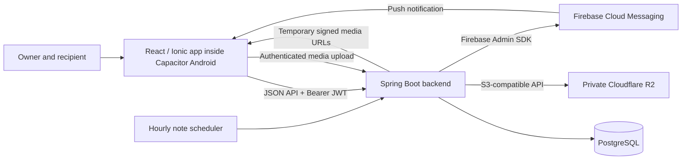

# Life Organizer — Complete Project Context for GPT

> Upload this document to a GPT project as a self-contained briefing. It explains the purpose, product experience, design, architecture, and current implementation without requiring access to the repository.
>
> Snapshot: October 7, 2026. Based on repository documentation and source-code inspection. “Implemented” means present in the code; it does not certify deployment or real-device testing. No private credentials are included.

## October 17, 2026 implementation update

Two shared French notebooks are implemented. **On regarde quoi ?** lets both accounts manage films/series with À voir/En cours/Vu statuses, notes, filters and search; after Vu, each user can manage their own 1–5 star review/comment while seeing both opinions. **Nos recettes** stores À essayer/Nos favoris recipes with servings, optional duration, ordered ingredient/amount fields, preparation steps and tips. Both accounts can author recipes. Ingredient structure supports a later shopping-list feature; that integration remains future work. These modules require the updated backend/mobile deployment and no new external service credentials. See [cinema](mobile/src/modules/watchlist/README.md) and [recipes](mobile/src/modules/recipes/README.md).

## October 16, 2026 implementation update

Mes envies is implemented: the recipient manages a shared list of gift ideas (objects, books, experiences), and the owner can read it. Each wish has a title/category and optional private R2 photo, HTTP/HTTPS link and details. Wishes persist until removed; only memory categories expire after 72 hours. Replaced/deleted wishlist photos are removed by a retryable worker, and abandoned uploads are cleaned after 24 hours. See [module details](mobile/src/modules/wishes/README.md).

Memory categories are now temporary: 72 hours from creation, then hidden immediately and their photos/audio physically removed by a retryable backend cleanup worker. New uploads use private Cloudflare R2 through the authenticated backend, with temporary signed read URLs. The Supabase frontend SDK is removed. The owner explicitly requested erasure of all previous memories; there is no media migration. Deployment and R2/legacy-Supabase deletion credentials are still required for live cutover. See [the storage guide](backend/R2-SETUP.md) and [validation report](design-validation/temporary-memories/README.md).

Birthday Reminders is also implemented: private annual dates per user, 3-day and 1-day alerts at 19:00 Moroccan GMT. See [the birthday report](design-validation/birthday-reminders/README.md). Home/notes account for Morocco's September 2026 return to GMT even with stale runtime timezone data.

## 1. The whole idea

Life Organizer is a private mobile app created by the owner as a birthday gift for his partner. It is built for one specific person, with content, language, and experiences chosen for her. The emotional purpose is as important as the practical functionality: the app should make her feel remembered, supported, and cared for in everyday life.

The central idea is to give that care a permanent home on her phone. A note can arrive when she needs encouragement. A photo and a voice recording can bring back a shared memory. A workout plan can help her build a routine with guidance from someone who knows her. These experiences belong together because they come from the same relationship.

There are three initial modules:

- **Notes:** small personal messages, sent immediately or prepared for a future moment.
- **Memory Timeline:** shared moments preserved through photos, captions, and the owner's voice.
- **Gym Coach:** personally curated workouts, with simple guidance and progress tracking.

The birthday is the starting point. The longer-term idea is a living gift: new modules and new content can be added as her needs and their shared life evolve. The home screen treats modules like chapters, so the app can grow without a new navigation system or a rewrite.

The name is **Life Organizer**. **“Kept”** is the name of the current design concept, not a confirmed product rename.

### What should guide every decision

1. **Personal relevance:** a feature should serve her or their shared life.
2. **Care in the details:** tone, content, timing, and presentation should feel intentional.
3. **Ease of use:** reading a note, revisiting a memory, or starting a workout should take little effort.
4. **Privacy:** personal messages and memories belong to the two participants.
5. **Continuity:** the architecture should make adding the next useful module straightforward.
6. **Daily reliability:** this is intended for real use, so saved content and progress must be dependable.

Success means she wants to return to the app because it feels useful and personal. Downloads, public engagement, monetization, and growth are outside the current brief.

## 2. People and roles

The product is intended to have exactly two accounts. Both use the same app and backend. Their roles determine what they can create and see.

| Role | Person | Main capabilities |
|---|---|---|
| `OWNER` | The creator of the gift | Write and schedule notes, curate memories, manage exercise content and programmes, train alongside her, and view progress. |
| `RECIPIENT` | His partner | Read delivered notes, revisit memories, follow the active workout programme, and record her activity. |

Accounts are seeded by the backend. There is no public registration flow. The owner dashboard consists of role-specific controls inside the same mobile application; there is no separate admin application in the repository.

The two-account rule is a product assumption implemented through seeding and the absence of registration. It should not be described as a database constraint that makes additional rows impossible.

## 3. The experience from opening the app

### Entry and navigation

The app opens with a short branded splash screen, then shows either login or the authenticated interface. The splash uses the heart mark, the Life Organizer wordmark, and “made just for you.” Login says “Everything in here is just for you.”

Only **Home** and **Profile** are permanent bottom tabs. Modules open as additional screens with back navigation. This keeps the home screen expandable as new modules arrive.

Home contains a time-sensitive greeting with the user's name, the current date/time, module rows with their own accents, a conditional workout-streak summary, and a “More / Coming soon” entry.

Profile displays the user's name and role, basic content/activity counts, an about message, and logout. Notifications opens a private birthday reminder inbox with individual deletion; edit profile remains “Coming soon.” Birthday messages are saved at the 3-day and 1-day thresholds from 7pm, even without successful phone push delivery. Removing a message preserves the birthday and future reminders. “Forgot password?” on login displays a personal instruction to ask the owner; there is no automated password-reset workflow.

### Notes: care that arrives at the right time

The owner writes a text message and chooses **Send now** or **Schedule**. The scheduling interface provides date chips for the next 21 days and whole-hour time choices. It converts the chosen local time to a UTC instant for the backend.

The owner sees separate scheduled and sent sections. A scheduled note can be cancelled before delivery. The recipient sees only delivered notes, newest first; the backend performs this filtering.

Current rules and behavior:

- Text is required and limited to 4,000 characters by backend validation.
- Without `scheduledFor`, creation immediately marks the note `SENT` and attempts a push notification.
- A future `scheduledFor` creates a `SCHEDULED` note.
- The service rejects an already occupied scheduled timestamp. The UI uses hourly slots; the API does not itself normalize arbitrary timestamps to an hour.
- The scheduler runs at the start of each hour and claims **one** due note per run, including overdue notes.
- Claiming uses a PostgreSQL atomic update with `FOR UPDATE SKIP LOCKED` to avoid two workers claiming the same note.
- Cancelling changes the status to `CANCELLED`; it does not delete the record. Cancelled notes are excluded from the normal feeds.
- There is no note-edit endpoint or draft-saving interface at present. `DRAFT` remains an enum value.
- `audioUrl` exists in the model for future note audio; the current note composer and feed are text-based.

Note delivery and push delivery are separate. A note can be saved as `SENT` even if its push fails. The backend tracks `notificationStatus` and `notificationSentAt` independently, so notification failure does not make the note disappear or become scheduled again.

### Memory Timeline: a slow walk through shared moments

The owner attaches a photo from the camera or gallery, selects the date the memory happened, and adds a caption or records a voice note. The current composer switches between caption and audio modes; although the data model supports both fields, this interface saves one mode at a time.

Photos and recordings upload through the authenticated backend to **private Cloudflare R2**. The app saves tracked asset IDs with the memory metadata. Categories expire 72 hours after creation; the backend hides them at expiry and deletes their photos, audio and records with retries.

The timeline is ordered by memory date, newest first, grouped by month, and uses alternating photo cards with reveal animations. Photos open in a full-screen lightbox. Audio has playback controls and can also be played from the lightbox.

The intended experience is a short, unhurried visit through memories rather than a stream demanding constant interaction.

There is also a birthday-countdown screen. Before the configured unlock instant, Home sends the recipient there instead of the timeline; the owner can always open the timeline. The current constant is `2026-10-03T00:00:00+00:00`, which is already past at this snapshot. This is a frontend presentation gate: the API does not enforce a birthday embargo, and the `/memories` route remains accessible to authenticated users. The source comment's Morocco-time explanation should be verified before reusing or changing that date.

Memory creation and reading are implemented. There are no memory-edit/delete endpoints, and memory creation does not currently send a push notification.

### Gym Coach: guidance and encouragement in daily practice

Gym Coach has evolved beyond the original static-plan proposal. The owner can maintain a reusable exercise library, assemble programmes, and choose the active programme for both users.

An exercise library entry describes **what the movement is**: its name, instructions, muscle group, optional image URL, and optional video URL. A day exercise describes **how much to do in a particular session**: sets, reps, optional rest seconds, and an optional coaching note. Reusing an exercise in several sessions does not require duplicating its instructions.

The owner can create and edit programme days and replace their ordered exercise lists. Creating a programme when none is active makes it active. Activating another programme deactivates the others. Deleting the active programme promotes the newest remaining programme if one exists. Exercises still referenced by a programme cannot be deleted.

Both users can open the active programme and tick exercises as they train. Sessions show a progress ring, movement details, prescribed sets/reps, and rest guidance. The interface attempts to log the session when the final exercise is checked, then shows a celebration and an encouraging message. Ticks use optimistic UI updates and optional device haptics.

Progress includes streaks, a weekly activity strip, a roughly 12-week heatmap, session counts, and achievement badges. The dedicated progress screen gives the owner a **Hers / Mine** view; the recipient sees her own logs. A starter exercise library and three-day programme are seeded when the library is empty.

The backend associates ticks and workout logs with the authenticated user, but read endpoints return both users' activity. Some session and hub calculations currently combine those records. Per-person progress and once-per-day completion should be treated as intended behavior that needs careful validation, rather than assuming every screen and backend write already enforce it consistently.

### Future chapters

The original next-module idea is a shopping list. The current “More” page also names shared calendar, grocery and meal planning, budget and bills, and travel plans. These are placeholders and possible directions, not completed features or an agreed implementation schedule.

## 4. Visual design and writing style

The current direction is **v3, “Kept”**: warm, light, intimate, and restrained. Romantic details should feel mature and personal. The shared background and typography connect the modules while their accent colors make each chapter recognizable.

### Palette

| Token / role | Value | Use |
|---|---|---|
| Background / paper | `#FBF4EE` | Main warm blush-white background. |
| Surface | `#FFFFFF` | Cards and raised areas. |
| Mist | `#F1E4E6` | Tinted strips and pills. |
| Line | `rgba(43, 30, 36, 0.12)` | Dividers and subtle borders. |
| Ink | `#2B1E24` | Primary text. |
| Muted ink | `#8A6483` | Timestamps, secondary copy, hints. |
| Rose | `#C65D7B` | Notes, primary actions, part of the heart mark. |
| Plum | `#4A1942` | Memories and selected headings. |
| Gold | `#B8935A` | Gym Coach and part of the heart mark. |
| Dark plum | `#34102E` | Splash backdrop. |

Current Ionic mapping: `primary` = rose, `secondary` = gold, `tertiary` = plum. General CSS tokens live in `mobile/src/index.css`; Ionic variables live in `mobile/src/theme/variables.css`.

### Typography, identity, and components

- **Fraunces:** display serif for the wordmark, screen titles, and special personal text. Upright for headings; italic for greetings, captions, and personal moments.
- **Inter:** body text, controls, labels, and other UI text.
- **Logo:** a geometric heart split into rose and gold halves. Root assets are `icon.svg` and `logo.svg`; the reusable in-app component is `HeartMark.tsx`.
- **Composition:** generous breathing room, soft rounded controls, understated borders, editorial module rows, and clear touch targets.
- **Motion:** brief transitions, memory reveals, and workout celebrations should support the moment. Keep reduced-motion behavior in mind when extending animation.
- **Language:** short, familiar, affectionate where appropriate, and useful. Existing examples include “made just for you,” “take a slow walk,” and “Your plan is being written. Check back soon ♥”.

Use existing design tokens and shared components when extending the UI. `DESIGN.md` and `app-design.html` describe the current direction. `mockups.html` represents the older v2 direction. Older mentions of emerald and Plus Jakarta Sans are superseded by plum and Inter.

## 5. Technical architecture

This is a single repository with a mobile frontend and one Spring Boot backend. The backend is a modular monolith: domain packages stay separate while sharing authentication, configuration, and infrastructure.

| Layer | Current technology | Responsibility |
|---|---|---|
| Frontend | React 19, TypeScript 6, Vite 8 | Screens, local UI state, client API calls. |
| Mobile UI | Ionic React 8, Ionic React Router, React Router 5 | Mobile primitives, tabs, modals, and navigation. |
| Native shell | Capacitor 8, Android | Installable app and native device capabilities. |
| Backend | Java 21, Spring Boot 4.1.0, Maven | Business rules, auth, scheduling, persistence, push sending. |
| Persistence | PostgreSQL, Spring Data JPA / Hibernate | Users, notes, memory metadata, programmes, and progress. |
| Authentication | Spring Security, BCrypt, JJWT | Password verification and stateless JWT authorization. |
| Push | Firebase Cloud Messaging, Firebase Admin SDK, Capacitor push plugin | Sending notifications to the recipient's registered device. |
| Media | Private Cloudflare R2, AWS SDK S3 client on the backend | Authenticated multipart uploads, tracked files, signed reads and automatic deletion. |
| Device features | Capacitor Camera, Haptics, Keyboard, App; community voice recorder | Photo selection/capture, feedback, keyboard/back handling, recording. |

Versions above are repository declarations, not claims about the latest available releases. `capacitor-voice-recorder` is currently declared at major version 7 while the main Capacitor packages are major version 8; native compatibility still needs device validation.

### System flow



Cloudflare R2 handles media only. Spring Boot authentication and the JPA database remain. Supabase access is retained server-side only to erase previous memory files, not to migrate or upload new content.

### Frontend organization

```text
mobile/
  src/
    modules/
      splash/        branded entry screen
      home/          module hub
      notes/         feed, composer, notesApi
      memories/      timeline, countdown, memoriesApi
      gym/           hub, library, programmes, editor, session, progress, components
      profile/       account summary and settings placeholders
      coming-soon/   future module presentation
    shared/
      api/           typed JSON client and API errors
      auth/          AuthContext and LoginPage
      navigation/    Android back handling
      push/          native push registration hook
      storage/       authenticated R2 upload helper
      ui/            HeartMark and BrandHeader
      utils/         date/progress helpers and visibility hook
    theme/           Ionic theme variables
    App.tsx          splash, auth routing, tabs, module routes
    App.css          shared screen styling
    index.css        design tokens and base styles
  android/           native Android project
  assets/            icon/splash source assets
  capacitor.config.ts
  package.json
```

Module API files wrap the shared `apiRequest` function. Auth is shared through React context; screen state primarily uses React hooks. Requests attach a Bearer token and parse JSON errors. A `401` invokes the registered logout handler so an expired or rejected token returns the user to login.

JWT and user metadata currently persist in `localStorage`. There is no refresh-token flow in the inspected code.

### Backend organization

```text
backend/src/main/java/com/lifeorganizer/
  auth/       User, login DTOs, auth service, JWT service/filter, repository
  notes/      Note, DTOs, controller, service, repository, scheduler, statuses
  memories/   Memory, DTOs, controller, service, repository
  gym/        library, programmes, days, prescriptions, ticks, logs, APIs
  push/       PushService and test-push controller
  config/     security, Firebase, errors, environment loading, schema fixups
  seed/       account and starter gym-content seeding
  LifeOrganizerApplication.java
```

The normal request path is **controller → service → repository → PostgreSQL**. Controllers define endpoints and role checks; services implement business rules and transactions; repositories perform persistence. Request/response DTOs keep API contracts separate from entities. Shared exception handling maps failures to HTTP responses.

Authentication is stateless. Only `POST /api/auth/login` is public under `/api`; other API requests require a valid JWT. Owner-only writes use controller-level `@PreAuthorize` checks. Server authorization is necessary even when the recipient UI hides authoring links.

## 6. Data model overview

All primary entity IDs are UUIDs. Event timestamps generally use Java `Instant`; memory dates and exercise tick dates use `LocalDate`.

| Entity | Important fields / relationships |
|---|---|
| `User` | `id`, `role` (`OWNER` / `RECIPIENT`), `name`, BCrypt `passwordHash`, optional `fcmToken`. Name is used as the login username. |
| `Note` | `content`, optional `audioUrl`, `status` (`DRAFT`, `SCHEDULED`, `SENT`, `CANCELLED`), `scheduledFor`, `sentAt`, `createdAt`, separate notification status (`PENDING`, `SENT`, `FAILED`) and attempt timestamp. |
| `Memory` | Required `photoUrl` and `memoryDate`, optional `caption` and `audioUrl`, `createdAt`. |
| `LibraryExercise` | Reusable `name`, `instructions`, `muscleGroup`, optional image/video URLs, `createdAt`. |
| `Programme` | `name`, optional `description`, `active`, `createdAt`, ordered days. |
| `ProgrammeDay` | Parent programme, `label`, optional `coachNote`, `sortOrder`, ordered day exercises. |
| `DayExercise` | Parent day, reference to library exercise, `sets`, string `reps`, optional `restSeconds` and `note`, `sortOrder`. |
| `ExerciseTick` | `dayExerciseId`, `userId`, `tickDate`, `completedAt`. |
| `WorkoutLog` | `programmeDayId`, `userId`, `completedAt`. Older logs may have no user ID. |

Muscle groups are `LEGS`, `GLUTES`, `CORE`, `UPPER_BODY`, `CARDIO`, `FULL_BODY`, and `MOBILITY`. Reps remain text so prescriptions such as “12,” “30 sec,” or “10 per leg” can share the same model.

Schema creation/update currently uses `hibernate.ddl-auto: update`. `SchemaFixups` updates the notes-status check constraint on startup. No versioned migration framework is present in the inspected dependency list. Account seeding skips roles that already exist; changing seed environment variables does not automatically change existing accounts.

## 7. Current API surface

All paths below are relative to the backend base URL. Every endpoint except login requires authentication.

| Method and path | Access / purpose |
|---|---|
| `POST /api/auth/login` | Public; username, password, optional FCM token → JWT and user metadata. |
| `GET /api/notes?page=0&size=50` | Both; role-filtered note feed. |
| `POST /api/notes` | Owner; send now or schedule. |
| `DELETE /api/notes/{id}` | Owner; cancel a scheduled note. |
| `GET /api/memories` | Both; memory timeline. |
| `POST /api/memories` | Owner; JSON media URLs, caption/audio metadata, and date. |
| `GET /api/gym/exercises` | Both; exercise library. |
| `POST /api/gym/exercises` | Owner; create a library exercise. |
| `PUT /api/gym/exercises/{id}` | Owner; edit a library exercise. |
| `DELETE /api/gym/exercises/{id}` | Owner; delete an unused library exercise. |
| `GET /api/gym/programmes/active` | Both; active programme, or `204` if absent. |
| `GET /api/gym/programmes` | Owner; all programmes. |
| `GET /api/gym/programmes/{id}` | Owner; one programme. |
| `POST /api/gym/programmes` | Owner; create a programme. |
| `PUT /api/gym/programmes/{id}` | Owner; edit or activate a programme. |
| `DELETE /api/gym/programmes/{id}` | Owner; delete a programme. |
| `POST /api/gym/programmes/{id}/days` | Owner; add a session/day. |
| `PUT /api/gym/days/{dayId}` | Owner; edit day label/coaching note. |
| `DELETE /api/gym/days/{dayId}` | Owner; delete a day. |
| `PUT /api/gym/days/{dayId}/exercises` | Owner; replace the day's ordered prescriptions. |
| `POST /api/gym/ticks` | Both; check/uncheck an exercise for the authenticated user and supplied date. |
| `GET /api/gym/ticks?days=60` | Both; recent ticks for both users. |
| `POST /api/gym/log` | Both; record a session completion for the authenticated user. |
| `GET /api/gym/log` | Both; completion history for both users. |
| `POST /api/push/test` | Authenticated; diagnostic push to the recipient. Currently has no owner-only annotation. |

Frontend destinations: `/login`, `/home`, `/profile`, `/notes`, `/notes/compose`, `/memories`, `/memories/countdown`, `/gym`, `/gym/exercises`, `/gym/programmes`, `/gym/programmes/:programmeId`, `/gym/day/:dayId`, `/gym/progress`, and `/more`.

## 8. Notifications, media, and runtime configuration

### Push lifecycle

On native platforms, login requests notification permission and registers the device through the Capacitor push plugin. If the token is available when the user submits login, it is sent with the credentials and stored on the user record.

When a note is sent, the backend attempts to notify the recipient through Firebase Admin. The message contains a title and the note text. FCM acceptance is recorded as notification success; it is not proof the recipient actually received or read the notification.

Firebase configuration is optional at backend boot. Missing credentials, missing device tokens, or send failures result in skipped/failed pushes while the app can continue serving saved content. Automatic retry, delivery receipts, and token-refresh synchronization are not implemented. Notification-receive and tap listeners currently log events; module-specific tap navigation is still pending.

### Media lifecycle

`mobile/src/shared/storage/mediaStorage.ts` creates a Supabase client from Vite environment variables, uploads a blob to the `media` bucket, and returns its public URL. The app saves that URL through the memory API. The repository's older Firebase Storage comments do not describe the active upload helper.

The product is private, but the current upload helper returns public URLs. Storage policies and URL access therefore need to be considered separately from API authentication. There is no demonstrated signed-URL or Spring-JWT-to-storage authorization flow in this helper.

### Configuration names

| Area | Environment variables |
|---|---|
| Frontend API | `VITE_API_URL` (defaults to `http://localhost:8080`). |
| Frontend media | `VITE_SUPABASE_URL`, `VITE_SUPABASE_ANON_KEY`. |
| Backend database | `DB_URL` (JDBC URL), `DB_USERNAME`, `DB_PASSWORD`. |
| Backend JWT | `JWT_SECRET`, `JWT_EXPIRATION_MS` (default expiry: seven days). |
| Account seeding | `SEED_OWNER_USERNAME`, `SEED_OWNER_PASSWORD`, `SEED_RECIPIENT_USERNAME`, `SEED_RECIPIENT_PASSWORD`. |
| Backend CORS | `CORS_ALLOWED_ORIGINS`. |
| Server Firebase | `FIREBASE_SERVICE_ACCOUNT_PATH`. |

Vite variables are embedded in the frontend build and should contain only values suitable for client exposure. Firebase service-account material and database/JWT secrets belong on the backend, outside committed source and GPT uploads.

The Android identity is `com.lifeorganizer.app`; Capacitor bundles `mobile/dist`. Android Firebase setup uses `google-services.json` in the native project.

### Development and distribution

The frontend includes `dev`, `build`, `lint`, `preview`, and `assets` scripts. A pnpm lockfile is present. The existing npm-script commands are:

```bash
# From mobile/
npm run dev
npm run lint
npm run build
npx cap sync android
npx cap open android

# From backend/
./mvnw spring-boot:run
./mvnw test
```

Use a Node runtime compatible with the declared Vite/toolchain versions; the original setup document's Node 18 prerequisite should not be assumed current. Java 21 and Android Studio are part of the documented workflow.

Distribution targets a signed, sideloaded Android APK. Browser development provides quick UI iteration; native functionality needs an emulator or device. The repository has an Android project and no inspected iOS project.

The backend includes a multi-stage Dockerfile. `DEPLOY.md` describes Render for the backend and Neon for PostgreSQL. Treat these as documented deployment choices, not evidence of a currently running service or verified hosting plans/prices. Backend uptime matters for scheduled notes: an in-process scheduler cannot run while the service is asleep or stopped, and the current worker only drains one overdue note each hour.

## 9. Current implementation versus original documents

The repository has real feature implementations. The initial eight-week plan and scaffold instructions are historical context, not a current progress report.

| Topic | Original proposal / older text | Current source |
|---|---|---|
| Media storage | Firebase Storage. | Supabase Storage; Firebase remains for push. |
| Notes scheduling | Poll every 60 seconds. | Hourly cron; one due note claimed per run. |
| Notes editing | `PATCH` before sending. | No edit endpoint; cancellation only before sending. |
| Memory upload API | Described as multipart in the early API list. | JSON metadata after direct client upload. |
| Gym model | `WorkoutDay`, `Exercise`, simple completion log. | Reusable library, programmes, ordered days/prescriptions, user ticks and logs. |
| Navigation | Early module-tab scaffolding. | Home and Profile tabs; modules open as additional screens. |
| Design | Rose/gold/emerald, Plus Jakarta Sans in older prompt text. | Rose/plum/gold, Fraunces + Inter. |
| Push taps / memory pushes | Intended relevant-feed navigation and memory notifications. | Tap events logged; notes trigger push, memory creation does not. |

Present in code: authentication, seeding, branded entry/home/profile screens, notes creation/scheduling/cancellation/feed, memory upload/recording/playback/timeline/lightbox/countdown, gym authoring and sessions, progress visuals, and future-module placeholders.

Still incomplete or requiring validation: profile editing, notification settings, automated password reset, note audio/drafts/editing, memory editing/deletion, push tap routing and refresh/retry behavior, server-enforced birthday unlocking if required, and consistent per-person workout calculations/completion protection. Live deployment, storage policies, scheduler reliability, and real-device native behavior were not verified for this briefing.

## 10. How GPT should help with this project

Use this document as the project's starting context. Preserve its personal purpose when discussing product decisions, design, copy, architecture, or implementation.

- Keep the two-role experience and existing technology stack unless the owner explicitly requests a change.
- Keep features in their domain folders/packages and use shared code for genuinely shared concerns.
- Maintain the warm v3 design, module accents, Fraunces/Inter typography, and heart identity.
- Make recommendations proportional to a private two-person app while treating personal data and reliability with care.
- Explain whether a statement describes the product vision, behavior found in source, a known limitation, or a proposed improvement.
- Do not assume placeholders are working features, documentation proves deployment, or a hidden button is an authorization boundary.
- When repository access is available, check current source before relying on older documentation. This snapshot can become stale.
- When repository access is unavailable, request the relevant current files for exact implementation work instead of inventing contracts or unseen code.
- Keep future-module ideas separate from approved scope. Ask for missing product decisions when they materially affect a requested change.
- Do not infer a commercial roadmap, public signup, subscriptions, or social features from the app's name.

Suggested opening instruction for the GPT project:

> You are helping me develop Life Organizer, a private Android app I am building as a birthday gift for my partner. Read PROJECT_CONTEXT.md as the project brief. Understand the emotional idea first: this is a living, personal gift that combines caring notes, shared memories, and curated workout support, with room for future chapters. Help me with product decisions, UX, writing, architecture, and implementation while preserving the two-account model, the current stack, and the warm “Kept” design. Distinguish existing behavior from planned work, and verify current files before proposing exact code changes.

## 11. Repository references

These references help when source access is available; the essential context is already included above.

- `README.md`: original concept, three-module launch scope, and eight-week plan.
- `ARCHITECTURE.md`: initial models and proposed API/infrastructure design; several details have since changed.
- `DESIGN.md`: current v3 palette, typography, and brand direction.
- `app-design.html`: current visual reference; `mockups.html` is the older version.
- `implementation-guide.md`: companion design implementation notes; some code examples differ from the running source.
- `AGENT_PROMPT.md`: original build brief; contains superseded design/build assumptions.
- `SETUP.md`: original setup and Android packaging guide; verify older prerequisites and media-storage instructions.
- `DEPLOY.md`: documented backend deployment workflow.
- `mobile/src/` and `backend/src/main/`: primary references for implemented behavior.

**The essential idea to retain:** Life Organizer gives personal care a lasting place on her phone, beginning with three useful chapters and growing with their life together.
